# AnnWay – Diagramme de classes

Covoiturage vers les stations de ski (partenaire annski.fr).

```mermaid
classDiagram
    direction TB

    %% ───────────── Utilisateurs / Compte ─────────────
    class Utilisateur {
        <<abstract>>
        -int id
        -String nom
        -String prenom
        -String email
        -String telephone
        +gererProfil() void
        +laisserAvis(Utilisateur cible, int note, String commentaire) Avis
        +envoyerMessage(Trajet annonce, String contenu) Message
        +getNoteMoyenne() double
    }

    class Passager {
        +rechercherTrajet(CritereRecherche criteres) List~Trajet~
        +reserver(Trajet trajet, int nbPlaces, List~Materiel~ materiels) Reservation
        +creerDemandeTrajet(CritereRecherche criteres) DemandeTrajet
        +abonnerAlerte(CritereRecherche criteres) AlerteTrajet
    }

    class Conducteur {
        +publierTrajet(Trajet trajet) void
        +validerReservation(Reservation r) void
        +refuserReservation(Reservation r) void
    }

    class Profil {
        -String bio
        -String photo
        -boolean emailVerifie
        -boolean telephoneVerifie
        -boolean pieceIdVerifiee
        +verifierEmail() void
        +verifierTelephone() void
        +verifierPieceId() void
        +estVerifie() boolean
    }

    class Vehicule {
        -String immatriculation
        -String modele
        -int placesAssises
        -int capaciteMateriel
    }

    class Avis {
        -int note
        -String commentaire
        -String reponse
        -LocalDate date
        +repondre(String reponse) void
    }

    class Message {
        -String contenu
        -LocalDateTime dateEnvoi
    }

    Utilisateur <|-- Passager
    Utilisateur <|-- Conducteur
    Utilisateur "1" *-- "1" Profil
    Conducteur "1" o-- "1..*" Vehicule : possède
    Avis "*" --> "1" Utilisateur : auteur
    Avis "*" --> "1" Utilisateur : cible
    Message "*" --> "1" Utilisateur : expéditeur
    Message "*" --> "1" Trajet : annonce

    %% ───────────── Trajets ─────────────
    class Trajet {
        <<abstract>>
        -int id
        -String depart
        -String arrivee
        -LocalDateTime dateDepart
        -int placesDisponibles
        -int capaciteMaterielRestante
        -StatutTrajet statut
        +ajouterEtape(Etape etape) void
        +aAssezDePlace(int nbPlaces, List~Materiel~ materiels) boolean
        +correspond(CritereRecherche criteres) boolean
        +getType()* TypeTrajet
        +paiementObligatoire()* boolean
        +calculerMontantDu(int nbPlaces)* double
    }

    class TrajetStation {
        -double prixParPlace
        +getType() TypeTrajet
        +paiementObligatoire() boolean
        +calculerMontantDu(int nbPlaces) double
    }

    class TrajetPolytech {
        -LocalDateTime heureDepartBus
        -String stationDesservie
        +getType() TypeTrajet
        +paiementObligatoire() boolean
        +calculerMontantDu(int nbPlaces) double
    }

    class TypeTrajet {
        <<enumeration>>
        STATION
        POLYTECH
    }

    class Etape {
        -String lieu
        -LocalDateTime heurePassage
    }

    class StatutTrajet {
        <<enumeration>>
        OUVERT
        COMPLET
        TERMINE
        ANNULE
    }

    class CritereRecherche {
        -String depart
        -String arrivee
        -LocalDate date
        -int nbPassagers
        -TypeTrajet type
    }

    class DemandeTrajet {
        -LocalDate dateCreation
    }

    Conducteur "1" --> "*" Trajet : publie
    Trajet "*" --> "1" Vehicule
    Trajet "1" *-- "1..*" Etape
    Trajet --> StatutTrajet
    Trajet <|-- TrajetStation
    Trajet <|-- TrajetPolytech
    Trajet ..> TypeTrajet
    CritereRecherche --> TypeTrajet
    Passager "1" --> "*" DemandeTrajet : crée
    DemandeTrajet "1" *-- "1" CritereRecherche

    %% ───────────── Réservation ─────────────
    class Reservation {
        -int id
        -int nbPlaces
        -StatutReservation statut
        -LocalDateTime dateReservation
        +valider() void
        +refuser() void
        +annuler() void
        +getEncombrementTotal() int
        +payer(double montant, ServicePaiement service) Paiement
        +estPayee() boolean
    }

    class StatutReservation {
        <<enumeration>>
        EN_ATTENTE
        VALIDEE
        REFUSEE
        ANNULEE
    }

    class Paiement {
        -double montant
        -LocalDateTime date
        -TypePaiement type
        -boolean effectue
    }

    class TypePaiement {
        <<enumeration>>
        PRIX_FIXE
        DON
    }

    Passager "1" --> "*" Reservation : effectue
    Reservation "*" --> "1" Trajet
    Reservation --> StatutReservation
    Reservation "1" o-- "0..*" Materiel : déclare
    Reservation "1" o-- "0..1" Paiement
    Paiement --> TypePaiement

    %% ───────────── Patron SIMPLE FACTORY : matériel ─────────────
    class Materiel {
        <<abstract>>
        -String description
        +getEncombrement()* int
    }
    class Ski {
        +getEncombrement() int
    }
    class Snowboard {
        +getEncombrement() int
    }
    class Luge {
        +getEncombrement() int
    }
    class TypeMateriel {
        <<enumeration>>
        SKI
        SNOWBOARD
        LUGE
    }
    class MaterielFactory {
        +creerMateriel(TypeMateriel type, String description)$ Materiel
    }

    Materiel <|-- Ski
    Materiel <|-- Snowboard
    Materiel <|-- Luge
    MaterielFactory ..> Materiel : «crée»
    MaterielFactory ..> TypeMateriel

    %% ───────────── Patron OBSERVATEUR : alertes trajet ─────────────
    class SujetTrajets {
        <<interface>>
        +abonner(ObservateurTrajet o) void
        +desabonner(ObservateurTrajet o) void
        +notifier(Trajet trajet) void
    }
    class ObservateurTrajet {
        <<interface>>
        +actualiser(Trajet trajet) void
    }
    class CatalogueTrajets {
        -List~Trajet~ trajets
        -List~ObservateurTrajet~ observateurs
        -StrategieFiltre strategie
        +ajouterTrajet(Trajet trajet) void
        +rechercher(CritereRecherche criteres) List~Trajet~
        +setStrategie(StrategieFiltre s) void
    }
    class AlerteTrajet {
        -boolean active
        +actualiser(Trajet trajet) void
    }

    SujetTrajets <|.. CatalogueTrajets
    ObservateurTrajet <|.. AlerteTrajet
    CatalogueTrajets "1" o-- "*" ObservateurTrajet : notifie
    CatalogueTrajets "1" o-- "*" Trajet
    AlerteTrajet "*" --> "1" Passager : prévient
    AlerteTrajet "1" *-- "1" CritereRecherche

    %% ───────────── Patron STRATÉGIE : filtrage des résultats ─────────────
    class StrategieFiltre {
        <<interface>>
        +filtrer(List~Trajet~ trajets) List~Trajet~
    }
    class FiltreParPrix {
        -double prixMax
        +filtrer(List~Trajet~ trajets) List~Trajet~
    }
    class FiltreParHoraire {
        -LocalTime heureMin
        -LocalTime heureMax
        +filtrer(List~Trajet~ trajets) List~Trajet~
    }
    class SansFiltre {
        +filtrer(List~Trajet~ trajets) List~Trajet~
    }

    StrategieFiltre <|.. FiltreParPrix
    StrategieFiltre <|.. FiltreParHoraire
    StrategieFiltre <|.. SansFiltre
    CatalogueTrajets --> StrategieFiltre : utilise

    %% ───────────── Patron ADAPTATEUR : paiement (prix fixe ou don) ─────────────
    class ServicePaiement {
        <<interface>>
        +payer(Utilisateur payeur, double montant) boolean
    }
    class AdaptateurPaiementExterne {
        -ApiPaiementExterne api
        +payer(Utilisateur payeur, double montant) boolean
    }
    class ApiPaiementExterne {
        +sendPayment(String email, int amountCents) String
    }

    ServicePaiement <|.. AdaptateurPaiementExterne
    AdaptateurPaiementExterne --> ApiPaiementExterne : adapte
    Reservation ..> ServicePaiement : utilise
```

## Deux types de trajet

| | `TrajetStation` | `TrajetPolytech` |
|---|---|---|
| Destination | La station de ski directement | Polytech, pour prendre le bus ensuite |
| Paiement | **Obligatoire** : prix par place fixé par le conducteur (`PRIX_FIXE`) | **Facultatif** : don libre du passager (`DON`) |
| `paiementObligatoire()` | `true` | `false` |
| `calculerMontantDu(n)` | `prixParPlace × n` | `0` |
| Intérêt | Permet de skier même si le bus est plein | Rejoindre le départ du bus |

Règle : `Reservation.valider()` n'aboutit que si `!trajet.paiementObligatoire() || estPayee()`.

## Patrons de conception

| Patron | Classes | Justification |
|---|---|---|
| **Simple Factory** | `MaterielFactory`, `Materiel`, `Ski`, `Snowboard`, `Luge` | Centralise la création du matériel déclaré à la réservation ; ajouter un type (raquettes…) ne touche que la fabrique. |
| **Observateur** | `SujetTrajets`, `CatalogueTrajets`, `ObservateurTrajet`, `AlerteTrajet` | Cas « S'abonner alerte trajet » : à chaque publication, le catalogue notifie les alertes dont les critères correspondent. |
| **Stratégie** | `StrategieFiltre`, `FiltreParPrix`, `FiltreParHoraire`, `SansFiltre` | Cas « Filtrer les résultats (prix, horaire) » : l'algorithme de filtrage est interchangeable à l'exécution. |
| **Adaptateur** | `ServicePaiement`, `AdaptateurPaiementExterne`, `ApiPaiementExterne` | Paiement du prix fixe (trajet station) ou du don (trajet Polytech) : isole l'application de l'API de paiement tierce. |

## Correspondance cas d'utilisation → classes

| Cas d'utilisation | Classes / méthodes |
|---|---|
| Rechercher un trajet / Saisir critères | `Passager.rechercherTrajet`, `CritereRecherche`, `CatalogueTrajets.rechercher` |
| Filtrer les résultats | `StrategieFiltre` et ses implémentations |
| Réserver un billet / Déclarer le matériel | `Passager.reserver`, `Reservation`, `Materiel`, `MaterielFactory` |
| Payer le trajet (station, obligatoire) | `TrajetStation.prixParPlace`, `Reservation.payer`, `Paiement` (`PRIX_FIXE`), `ServicePaiement` |
| Effectuer un don (Polytech, facultatif) | `TrajetPolytech`, `Reservation.payer`, `Paiement` (`DON`), `ServicePaiement` |
| Créer demande de trajet | `DemandeTrajet`, `CritereRecherche` |
| S'abonner alerte trajet | `AlerteTrajet`, `CatalogueTrajets.abonner` |
| Gérer son profil / Vérifier pièce id | `Profil` |
| Laisser un avis / Répondre commentaire | `Avis`, `Avis.repondre` |
| Communiquer avec annonce | `Message` |
| Publier un trajet / Définir étapes, prix, places, capacité | `Conducteur.publierTrajet`, `TrajetStation` / `TrajetPolytech`, `Etape`, `Vehicule` |
| Gérer réservation / Valider-Refuser passager | `Conducteur.validerReservation` / `refuserReservation`, `Reservation` |
